# Fraktalne Bryły 3·6·9

Wizualizacja brył platońskich, na których ścianach rosną fraktale sterowane „matematyką 3‑6‑9”. Do tego generator
częstotliwości uznawanych za „lecznicze” (Solfeggio, 432 Hz, rezonans Schumanna, dudnienia binauralne) oraz
wizualizacje dźwięku w stylu Winampa, AVS i MilkDrop, które reagują na muzykę z YouTube albo z całego systemu.

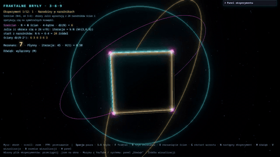

## Zrzuty ekranu

| | | |
|:-:|:-:|:-:|
| 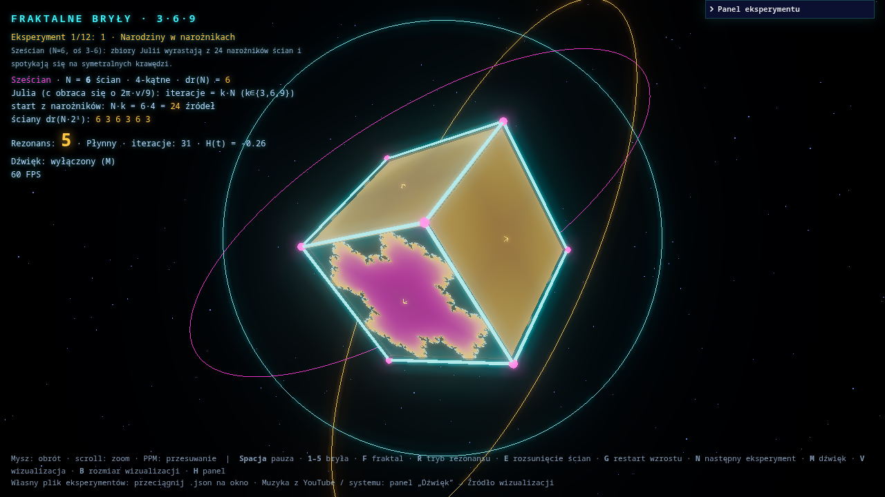 | 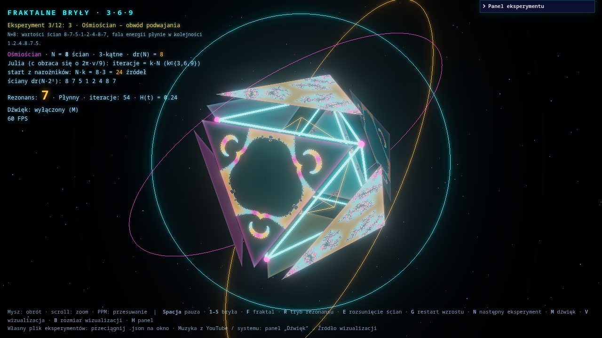 | 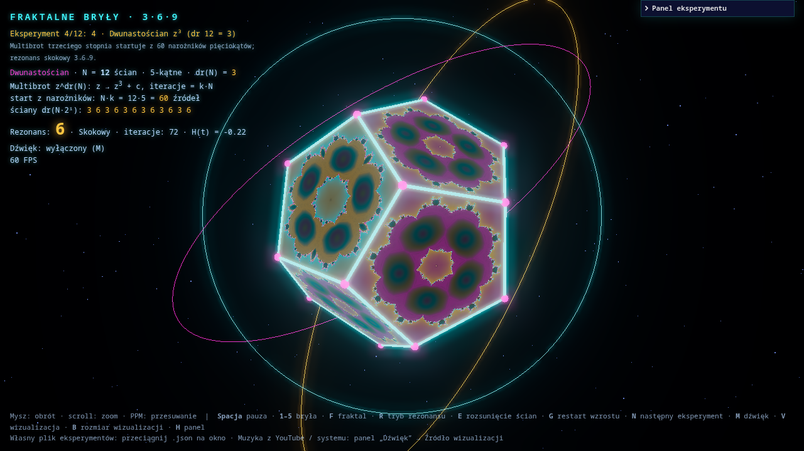 |
| Sześcian – zbiory Julii z narożników | Ośmiościan – obwód podwajania 1‑2‑4‑8‑7‑5 | Dwunastościan – Multibrot z³ |
| 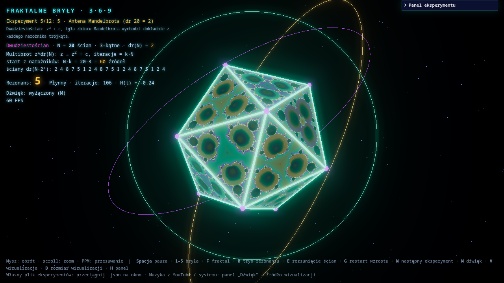 | 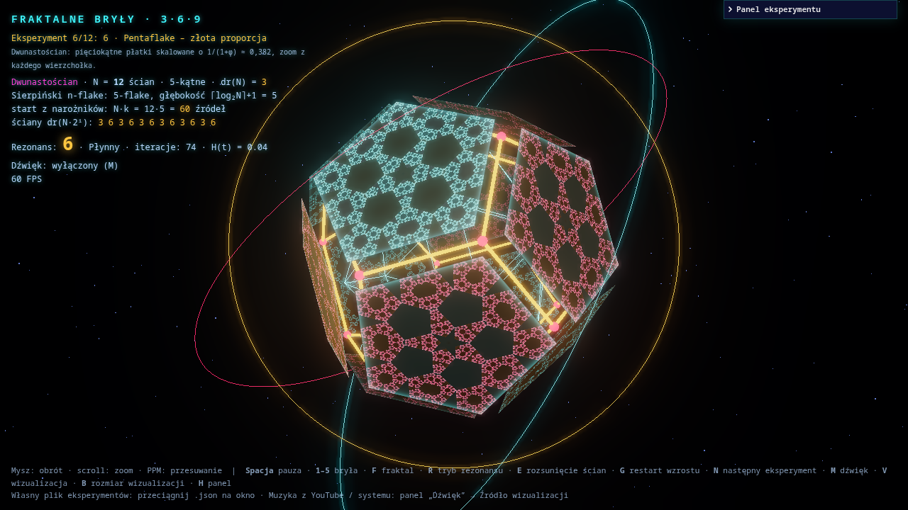 | 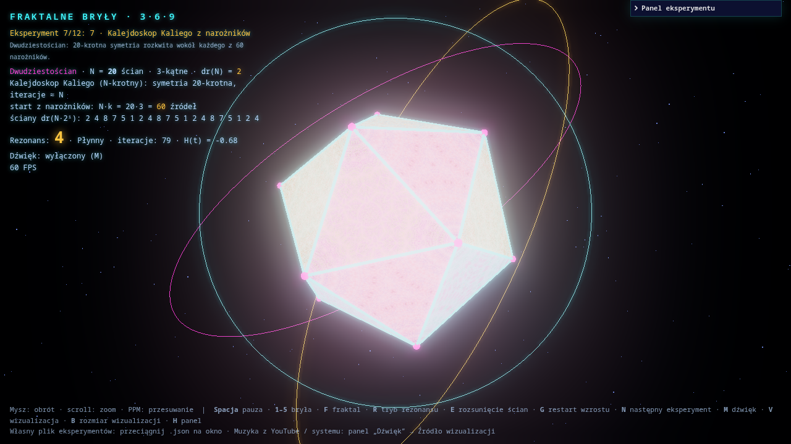 |
| Dwudziestościan – antena Mandelbrota | Pentaflake – złota proporcja | Kalejdoskop Kaliego |
| 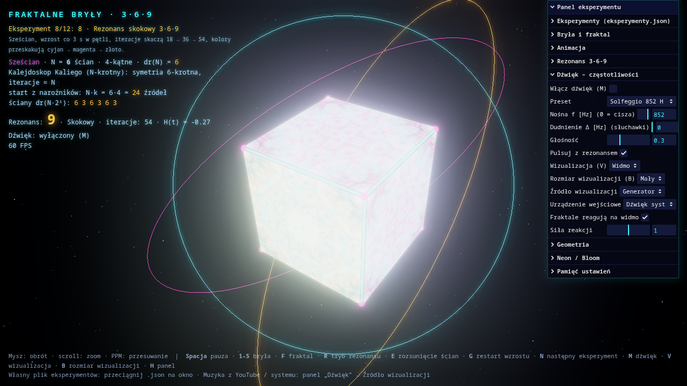 | 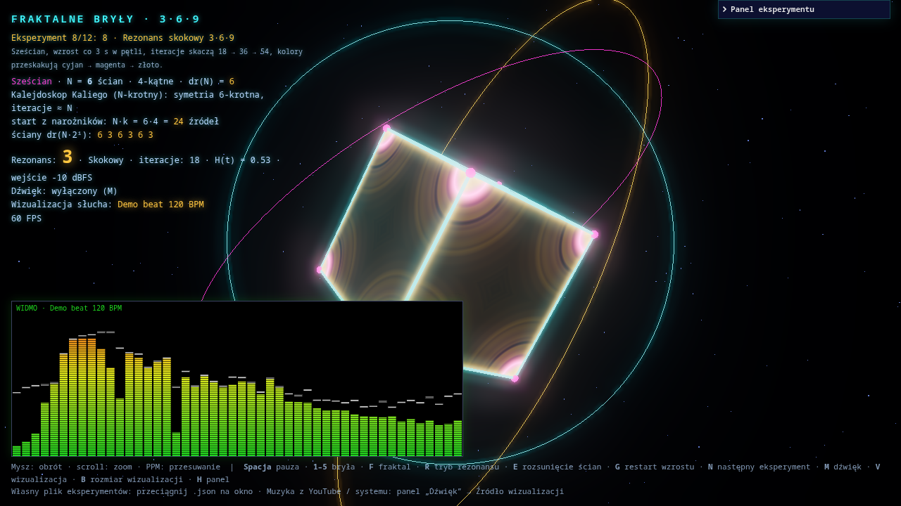 | 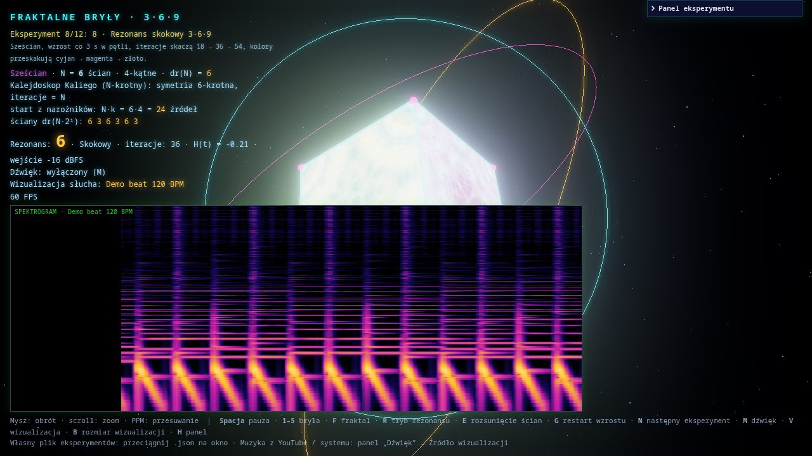 |
| Panel „Dźwięk – częstotliwości” | Widmo w stylu Winampa | Spektrogram (wodospad) |
| 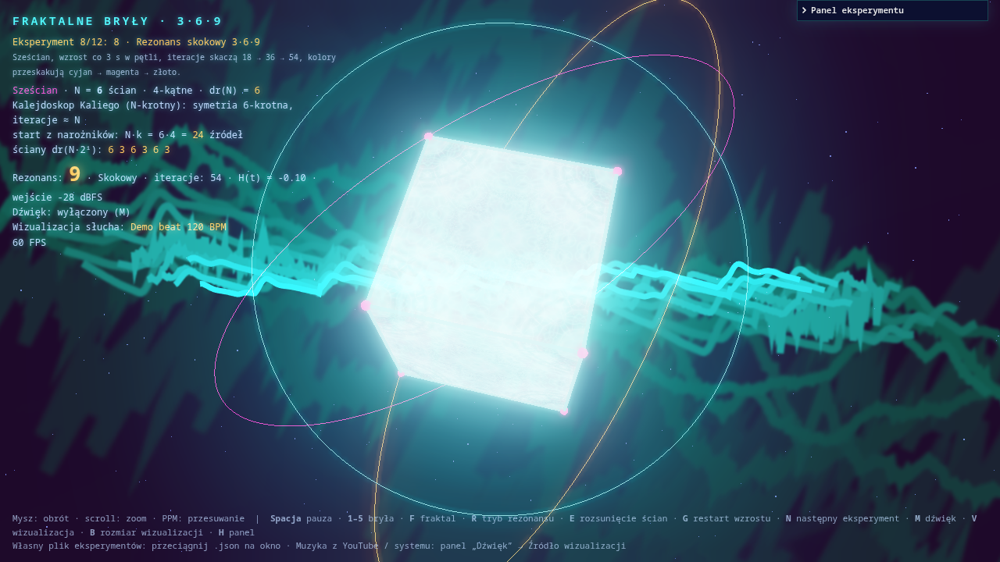 | 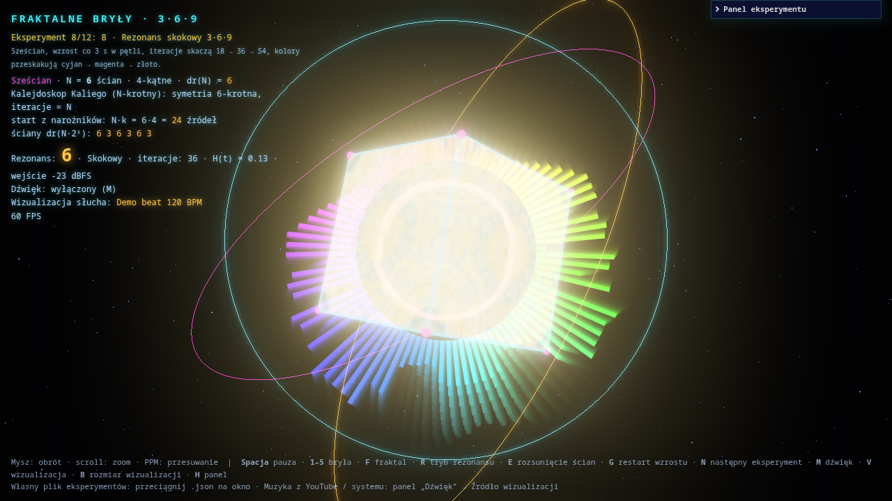 | 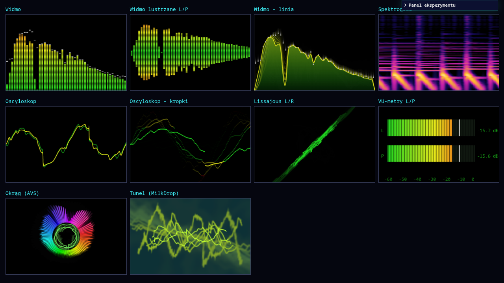 |
| Tunel (MilkDrop) jako nakładka na fraktale | Okrąg (AVS) jako nakładka | Wszystkie 10 trybów wizualizacji |

## Filmy

| Reakcja na muzykę | Nakładka MilkDrop / AVS | Rezonans Schumanna (Lissajous) |
|:-:|:-:|:-:|
| 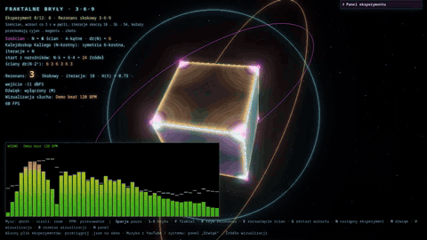 | 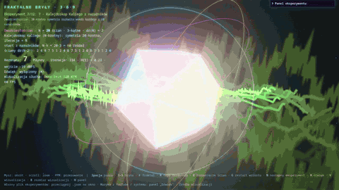 | 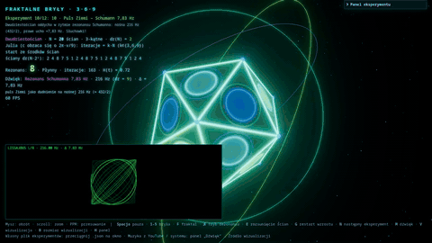 |

Pełne nagrania (MP4, 1280×720, 30 kl./s):
[przegląd eksperymentów](media/filmy/przeglad-eksperymentow.mp4) ·
[reakcja na muzykę](media/filmy/reakcja-na-muzyke.mp4) ·
[nakładka MilkDrop / AVS](media/filmy/nakladka-milkdrop-avs.mp4) ·
[rezonans Schumanna](media/filmy/schumann-lissajous.mp4)

Nagrania są bez dźwięku. W filmach „muzyka” to syntetyczny bit (stopa, werbel, hi‑hat, bas, akordy) generowany
w przeglądarce, żeby nie publikować cudzych utworów.

## Uruchomienie

Wymagany jest Python 3 (bez dodatkowych pakietów) i przeglądarka z WebGL2.

```bash
python main.py            # otwiera http://localhost:8000/index.html
python main.py --port 9000 --no-browser
```

Strony nie da się otworzyć jako `file://`, bo przeglądarki blokują wtedy wczytanie `eksperymenty.json`.
Serwer zapisuje też ustawienia światła i dźwięku (`ustawienia.json`, z kopią w ciasteczku).

## Co potrafi

**Bryły i fraktale**
- 5 brył platońskich (N = 4, 6, 8, 12, 20 ścian), płynne przejścia między nimi, bryła dualna, rozsuwanie ścian.
- 4 rodzaje fraktali w shaderze: zbiór Julii, Multibrot z^dr(N), Sierpiński n‑flake (trójkąt / Vicsek /
  pentaflake), kalejdoskop Kaliego.
- Fraktale rosną z narożników każdej ściany (albo ze środka) i spotykają się na symetralnych krawędzi.
- Matematyka 3‑6‑9: pierwiastek cyfrowy dr(N), wartości ścian dr(N·2ⁱ), obwód podwajania 1→2→4→8→7→5,
  rezonans o harmonicznych 3f, 6f i 9f (płynny albo skokowy).

**Dźwięk – częstotliwości „lecznicze”**
- Skala Solfeggio (174, 285, 396, 417, 528, 639, 741, 852 i 963 Hz). Każdy z tych tonów ma pierwiastek cyfrowy
  3, 6 albo 9.
- 432 Hz, OM 136,1 Hz, 111 Hz, rezonans Schumanna 7,83 Hz.
- Dudnienia binauralne fal mózgowych: delta, theta, alfa, beta, gamma 40 Hz (wymagają słuchawek).
- Głośność może „oddychać” razem z rezonansem 3‑6‑9.

> Opisy przy presetach to działanie *tradycyjnie przypisywane* tym częstotliwościom. W większości nie jest ono
> potwierdzone naukowo (wyjątkiem są badania nad stymulacją 40 Hz). Traktuj to jako relaks, nie terapię.

**Wizualizacja dźwięku (styl Winamp / AVS / MilkDrop)**
- 10 trybów: Widmo, Widmo lustrzane L/P, Widmo – linia, Spektrogram, Oscyloskop, Oscyloskop – kropki,
  Lissajous L/R, VU‑metry L/P, Okrąg (AVS), Tunel (MilkDrop).
- 4 rozmiary okna, w tym nakładka na cały ekran (czerń jest przezroczysta, więc widać fraktale pod spodem).
- Fraktale reagują na widmo. Każde pasmo częstotliwości rozświetla pierścień w innej odległości od narożnika,
  głośność „oddycha” zoomem i jasnością, a uderzenia basu rozbłyskują krawędziami.

**Źródło dźwięku dla wizualizacji**
- *Generator*: wbudowane tony.
- *Wejście audio / monitor systemu*: muzyka z YouTube, Spotify, czegokolwiek, co gra w systemie.
  Na Linuksie `main.py` tworzy wirtualne wejście `Dzwiek_systemu_FB369` (PulseAudio / PipeWire, przez `pactl`),
  podpięte pod monitor domyślnego wyjścia. Jest potrzebne, bo przeglądarki oparte na Chromium ukrywają źródła
  „Monitor of …”. Wejście znika po zamknięciu serwera.
- *Karta lub ekran*: przechwycenie dźwięku karty przeglądarki (Chrome / Edge / Brave).

## Sterowanie

| Klawisz | Działanie |
|---|---|
| Mysz / scroll / PPM | obrót / zoom / przesuwanie |
| Spacja | pauza |
| 1–5 | bryła |
| F | fraktal |
| R | tryb rezonansu |
| E | rozsunięcie ścian |
| G | restart wzrostu |
| N | następny eksperyment |
| M | dźwięk (generator) |
| V / klik w okno | tryb wizualizacji |
| B | rozmiar wizualizacji |
| H | panel |

## Eksperymenty

Plik [`eksperymenty.json`](eksperymenty.json) zawiera gotowe sceny (bryła, fraktal, rezonans, kolory, dźwięk).
Opis pól jest w kluczu `_instrukcja`. Własny plik można przeciągnąć na okno, a bieżące ustawienia pobrać
przyciskiem „Pobierz bieżące jako JSON”.

## Pliki

| Plik | Zawartość |
|---|---|
| `index.html` | cała aplikacja: Three.js, shadery, Web Audio, panel lil‑gui |
| `main.py` | lokalny serwer HTTP: ustawienia, wirtualne wejście z dźwiękiem systemu |
| `eksperymenty.json` | sceny do odtwarzania po kolei |
| `media/` | zrzuty ekranu i filmy z README |
